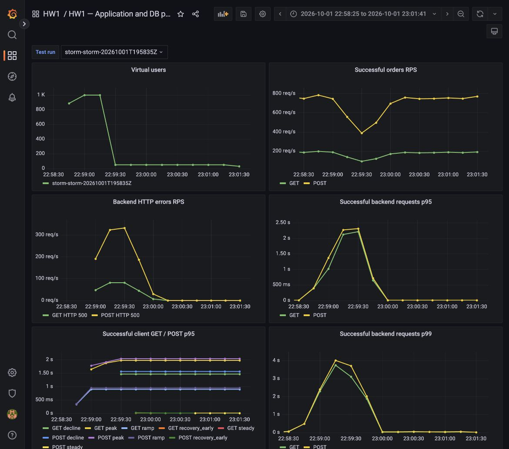
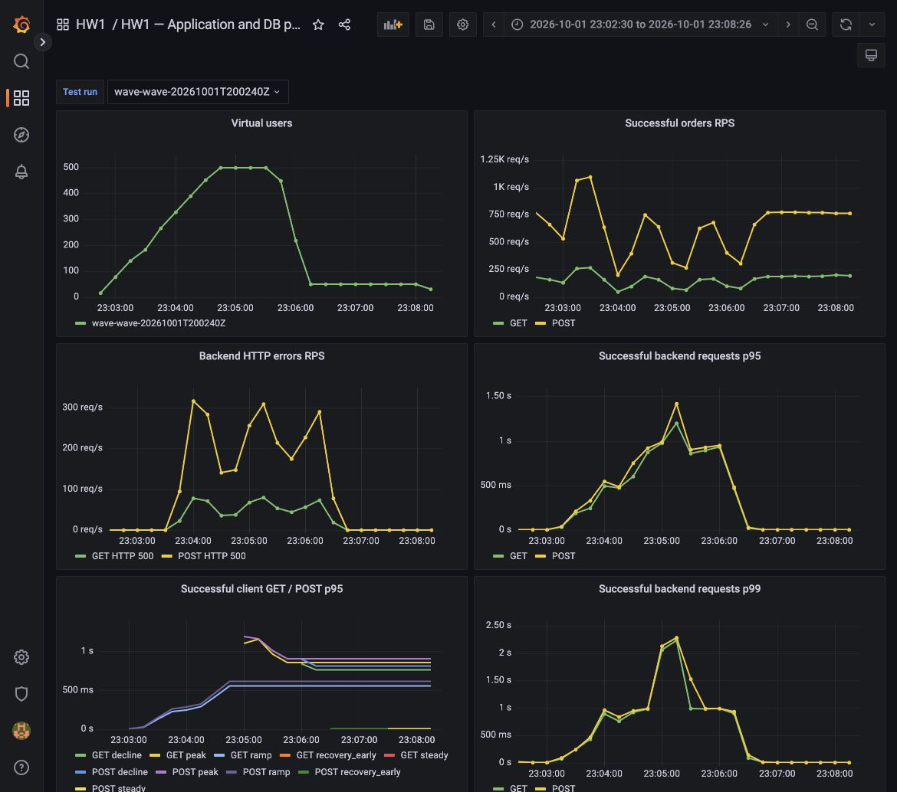
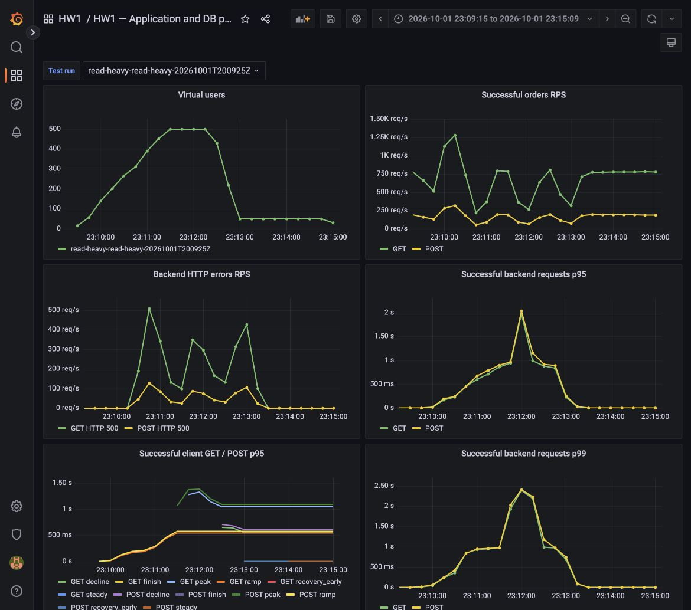

# HW1 — нагрузочное тестирование demo-app-1

## Архитектура и метрики

```text
k6 / браузер → Nginx → Go API → PostgreSQL
               └→ статический UI

Приложение и экспортеры → Prometheus → Grafana
```

Nginx отдаёт интерфейс и проксирует API-запросы в backend, предоставляя одну
точку входа. Go-приложение читает и создаёт заказы в PostgreSQL. Prometheus
собирает метрики приложения, БД и нагрузки, а Grafana показывает их на графиках.

Для поиска узких мест отслеживались:

| Метрики | Зачем нужны |
|---|---|
| Число пользователей и успешный RPS | Понять, сколько полезных запросов обслуживает система при росте нагрузки. |
| Доля ошибок | Увидеть, когда система перестаёт справляться. |
| p95/p99 успешных GET и POST | Оценить задержки чтения и записи для пользователей. |
| Время SQL-запросов и соединения БД | Проверить, связана ли деградация с PostgreSQL. |
| Соединения и ожидания пула приложения | Выявить проблемы управления подключениями. |
| CPU и RAM приложения и БД | Оценить давление на ресурсы. |

В приложение добавлены метрики открытых, занятых и свободных соединений пула,
а также числа и времени ожиданий. Показатель открытых соединений Go включает
подключения, которые ещё создаются, поэтому может превышать число сессий в БД.

## Сценарии

Стенд запущен в Docker VM с 4 CPU и 12 GiB RAM. Используется один backend.
В PostgreSQL установлен предел 200 соединений, а пул приложения не ограничивает
число открытых соединений и сохраняет только два свободных.

Все запросы проходят через Nginx. Перед каждым сценарием выполнялся базовый
замер при 50 пользователях в течение минуты с тем же соотношением GET/POST.

| Сценарий | POST / GET | Рост нагрузки | Нагрузка на пике |
|---|---|---|---|
| Шторм | 80% / 20% | 0 → 1000 пользователей за 10 с | 30 с |
| Волна | 80% / 20% | 0 → 500 пользователей за 2 мин | 60 с |
| Больше чтения | 20% / 80% | 0 → 500 пользователей за 2 мин | 60 с |

После пика нагрузка снижалась до 50 пользователей, восстановление наблюдалось
две минуты. Критерий восстановления: в последнюю минуту не более 1% ошибок,
а p95 GET и POST — не выше 120% базового значения.

Мой сценарий «Больше чтения» повторяет «Волну», но уменьшает долю записей.
Он проверяет, достаточно ли снизить число POST, чтобы разгрузить систему.
GET возвращает последние 100 заказов, POST создаёт один заказ.

## Результаты и анализ

| Сценарий | Доля ошибок | Средний успешный RPS | GET p95 / p99, мс | POST p95 / p99, мс | Максимум соединений пула Go, включая создаваемые |
|---|---:|---:|---:|---:|---:|
| Шторм | 11.22% | 846.9 | 955.7 / 1835.8 | 1020.7 / 1876.5 | 935 |
| Волна | 15.01% | 785.8 | 587.5 / 856.8 | 642.0 / 915.5 | 461 |
| Больше чтения | 16.84% | 833.2 | 579.1 / 948.3 | 620.9 / 994.1 | 434 |

RPS и перцентили рассчитаны за весь сценарий, включая восстановление.
Эти значения не определяют максимальную устойчивую производительность системы:
при росте задержек каждый виртуальный пользователь отправляет меньше запросов.

### Шторм

Резкий рост до 1000 пользователей вызвал HTTP 500 и ошибки PostgreSQL
`too many clients already`. Пул приложения вырос до 935 открытых и создаваемых
соединений. Одновременно увеличились задержки SQL и HTTP, а успешный RPS снизился.
После уменьшения нагрузки соединения и задержки вернулись к небольшим значениям.



### Волна

Плавное увеличение нагрузки также привело к отказам PostgreSQL. Дополнительно
появилась ошибка подключения `cannot assign requested address`: закончились
временные TCP-порты. Во время нагрузки обнаружено около 26,6 тысячи соединений
в состоянии `TIME_WAIT` при диапазоне около 28,2 тысячи портов.

Вероятная причина — частое создание и закрытие соединений при маленьком
числе сохраняемых свободных подключений. Эту гипотезу нужно проверить
повторным тестом с другими настройками пула.



### Больше чтения

Уменьшение доли POST не устранило отказы БД и ошибки TCP-подключений.
Средний успешный RPS вырос с 785,8 до 833,2, но доля ошибок также выросла
с 15,01% до 16,84%. Задержка GET почти не изменилась.

Чтение тоже обращается к БД, поэтому изменение состава запросов не решает
проблему управления соединениями.



### Восстановление и узкие места

| Сценарий | GET p95: до нагрузки → после, мс | POST p95: до нагрузки → после, мс | Ошибки после нагрузки |
|---|---:|---:|---:|
| Шторм | 4.42 → 5.24 | 5.56 → 6.59 | 0% |
| Волна | 3.66 → 3.53 | 4.44 → 4.06 | 0% |
| Больше чтения | 3.47 → 3.37 | 4.14 → 4.05 | 0% |

Во всех сценариях система восстановилась по выбранному критерию.
Основное узкое место — управление соединениями: приложение открывает их
без ограничения, PostgreSQL достигает своего предела, а частая смена
подключений расходует TCP-порты. Ожидания пула оставались нулевыми,
поскольку его размер не ограничен; это не означает отсутствия перегрузки.

CPU backend доходил примерно до 3,6 ядра при четырёх CPU у всей VM.
Конкуренция за CPU могла усиливать задержки, но её влияние отдельно не проверялось.

При перегрузке экспортер БД терял часть измерений, поэтому максимум числа
сессий в Grafana неполон. Каждый сценарий выполнен один раз, генератор делил
ресурсы со стендом. В сценарии «Больше чтения» k6 также записал некорректные
отрицательные минимальные задержки; min и avg не использовались для выводов.
