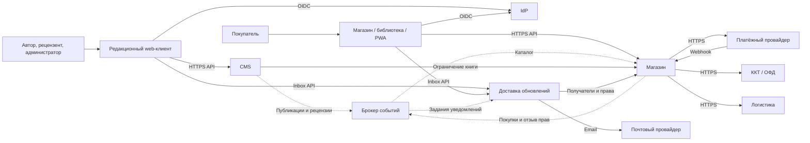
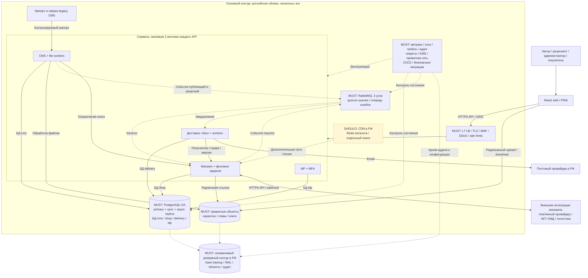

# HW2 — High Level Design издательской платформы Agile Dead Trees

## 1. Исходные требования

Основа решения — пример «Agile Dead Trees» из [HW1](hw1.md): платформа объединяет авторскую CMS и магазин издательства. Отчёт покрывает три части [HW2](hw2.md).

**Функциональные требования:**

- Авторы загружают главы и управляют версиями; рецензенты комментируют текст, авторы принимают или отклоняют правки.
- Администраторы назначают рецензентов, разрешают конфликты и управляют публикацией книг.
- Покупатели выбирают электронную или бумажную книгу, оформляют заказ и оплачивают его.
- Покупатели бета-книг получают доступ к новым опубликованным главам и уведомления об обновлениях.
- Система интегрируется с оплатой, фискализацией и доставкой бумажных книг; доступ определяется ролью и правами на книгу.

**Архитектурно значимые НФТ:** API p95 < 2 с, загрузка страницы < 3 с, обработка главы около 5 МБ < 10 с; доступность 99,9%; RPO < 5 мин и RTO < 15 мин. Предельные требования — 100 тыс. одновременных сессий и 10 млн транзакций в месяц. Размещение — российское облако, с защитой персональных данных и подготовкой к сертификации ИБ. Стек из HW1: React/TypeScript, Java/Spring и PostgreSQL.

Для выбора компонентов используем расчётные пики из HW1: около 100 RPS каталога и 100 TPS покупок. Они не доказывают выполнение требования 100 тыс. сессий: для него нужен отдельный профиль нагрузки. В оценке хранения также есть противоречие: (50 + 5 + 150 + 12,5) × 3 = 652,5 ТБ файлов с тремя копиями к концу года, ещё без бэкапов, тогда как итог HW1 — 300 ТБ. Ёмкость необходимо уточнить до выбора инфраструктуры.

В MVP включены CMS, магазин и бета-обновления. Рекомендации, роялти, партнёрские агрегаторы и мультиязычность отложены. Принятое допущение: новые главы доступны в библиотеке/PWA, а уведомления содержат ссылку на них.

## 2. Part 1 — сервисы и взаимодействия

### 2.1. Декомпозиция

Используем DDD: выделяем редакционный процесс, продажу и доставку уведомлений. Получаем три бизнес-сервиса и отдельный Identity Provider (IdP).

| Компонент | Ответственность | Обоснование границы |
|---|---|---|
| CMS | Книги, версии глав, рецензии, решения автора и публикация | Рецензия связана с версией главы, а публикация — с редакционным процессом; эти данные и правила остаются вместе |
| Магазин | Опубликованный каталог, поиск, цены, заказы, платежи, права доступа, фискализация и логистика | Подтверждение оплаты и выдача права выполняются в одном транзакционном контуре; разделение увеличило бы сложность основного сценария |
| Доставка обновлений | Уведомления о рецензиях, покупках и новых бета-главах | Массовые рассылки масштабируются отдельно; их задержка не блокирует покупку и чтение |
| IdP | Учётные записи, вход, роли и MFA | Общая аутентификация для всех клиентов; права на конкретную книгу проверяет магазин, права на редактирование — CMS |

Рецензирование остаётся модулем CMS, платежи и логистика — модулями магазина. При текущем масштабе выделять их в самостоятельные сервисы не требуется. Каждый сервис владеет своими данными; прямого доступа к таблицам другого сервиса нет.

### 2.2. Интеграции и выбор протоколов

| Взаимодействие | Способ | Обоснование |
|---|---|---|
| Web/PWA → бизнес-сервисы | Синхронный HTTPS API, JSON | Пользователю нужен непосредственный результат редактирования, поиска или создания заказа |
| Web/PWA → IdP | OIDC; сервисы проверяют токен по ключам IdP | Единый вход и MFA; локальная проверка токена не требует обращения к IdP на каждый запрос |
| CMS → магазин | Асинхронные события публикации через брокер | Магазин хранит свою проекцию каталога и не зависит от доступности CMS при каждом просмотре |
| CMS → магазин: ограничение книги | Синхронный внутренний HTTP API | Для запрета продаж/выдачи нужно подтверждение магазина; одной задерживаемой проекции недостаточно |
| CMS и магазин → доставка обновлений | Асинхронные события через брокер | Уведомления могут обрабатываться позже и повторяться при сбоях |
| Доставка → магазин | Синхронный внутренний HTTP API | Получение списка бета-покупателей и проверка актуальных прав |
| Магазин ↔ платёжный провайдер | HTTPS API и webhook подтверждения | Создание платежа и получение его результата; повторное подтверждение не должно создавать вторую покупку |
| Магазин ↔ ККТ/ОФД и логистика | HTTPS API, фоновые задания и обновления статусов | Фискализация и доставка имеют собственный жизненный цикл |
| Доставка → почтовый провайдер | HTTPS API | Внешняя доставка email отделена от доступности контента в библиотеке |
| Клиент → объектное хранилище | HTTPS по подписанной ссылке | Крупные файлы передаются без дополнительной нагрузки на бизнес-API; ссылку выдаём после проверки доступа |

Синхронное взаимодействие выбираем для операций с немедленным ответом, асинхронное — для распространения изменений и уведомлений. События сохраняются вместе с бизнес-изменением и доставляются с повторными попытками; потребители защищены от дубликатов. Подробные форматы сообщений относятся к реализации.

**Основные потоки:** после подтверждения оплаты магазин выдаёт право доступа и отправляет событие для уведомления. После публикации главы CMS обновляет каталог магазина через событие; доставка уведомляет бета-покупателей. Доступ к контенту не зависит от успешной отправки email.

### 2.3. HLD сервисов

Сплошные стрелки — API, пунктирные — события через брокер. Схема показывает клиентов, сервисы и внешние интеграции.

## 3. Part 2 — хранилища и масштабирование

### 3.1. Выбор БД по сценариям

Алгоритм из занятия в репозитории отсутствует. Используем последовательность: **данные → запросы → согласованность → нагрузка → выбор хранилища и альтернативы**.

| Сценарий | Требования к данным и запросам | Выбор и обоснование |
|---|---|---|
| CMS: версии, рецензии, решения автора | Связанные сущности, история и атомарная смена статуса; невысокая нагрузка | PostgreSQL: связи и транзакции соответствуют редакционному процессу. Документная БД не даёт очевидного преимущества |
| Магазин: каталог и поиск | Фильтры, сортировка, полнотекстовый поиск; преимущественно чтение | PostgreSQL с индексами и полнотекстовым поиском. Отдельный поисковый движок — при росте требований к релевантности или нагрузке |
| Магазин: заказы, платежи и права | Атомарное подтверждение оплаты, уникальность платежей и актуальность доступа | PostgreSQL: транзакции и ограничения целостности важнее распределённой записи. Кэш не является источником прав |
| Доставка: уведомления и статусы | Выборки по пользователю, пакетная обработка и защита от повторов | PostgreSQL для состояния и истории; брокер — для передачи событий и заданий |
| IdP: учётные записи | Изоляция идентификационных данных от бизнес-данных | PostgreSQL, схему которой управляет IdP |
| Файлы глав и книг | Большие неизменяемые объекты, доступ по ключу; десятки/сотни ТБ | Приватное S3-совместимое хранилище в РФ. В PostgreSQL остаются метаданные и ссылки, чтобы файлы не увеличивали размер основной БД и её бэкапов |

На старте четыре изолированные логические БД сервисов размещаются в одном HA-кластере PostgreSQL с отдельными ролями доступа. Это снижает эксплуатационные затраты, но оставляет общий ресурс и область отказа. При конкуренции за ресурсы БД доставки и магазина можно вынести в отдельные кластеры. Полнотекстовый поиск PostgreSQL описан в [документации](https://www.postgresql.org/docs/current/textsearch.html).

### 3.2. Репликация

| Компонент | Схема | Назначение и компромисс |
|---|---|---|
| PostgreSQL | Primary, синхронная и асинхронная реплики в разных зонах РФ | Синхронная реплика защищает подтверждённые записи, асинхронная используется для допустимо устаревших чтений. Оплата и проверка прав читаются с primary; синхронное подтверждение повышает задержку и может ограничить запись при отказе реплики |
| RabbitMQ | Три узла, quorum queues | События переживают отказ одного узла; при потере большинства обработка останавливается, события ожидают восстановления |
| Объектное хранилище | Управляемая избыточность по зонам и версии объектов | Защита от отказов оборудования и случайной перезаписи; точные гарантии зависят от провайдера |

Автоматический failover обеспечивает продолжение работы при отказе узла. Репликация не заменяет backup: ошибочное удаление также попадёт на реплики. Для PostgreSQL нужны резервные копии и архив WAL, для файлов — независимые резервные копии в РФ. Цели RPO/RTO проверяются восстановлением; RTO < 15 минут при потере всей площадки требует отдельного обоснования.

Основания: [репликация PostgreSQL](https://www.postgresql.org/docs/current/warm-standby.html), [PITR](https://www.postgresql.org/docs/current/continuous-archiving.html), [quorum queues RabbitMQ](https://www.rabbitmq.com/docs/quorum-queues).

### 3.3. Шардинг

Физический шардинг на старте не вводим: выбранная нагрузка не доказывает его необходимость, а распределение усложняет транзакции заказа и выдачи права. Сначала используем индексы, реплики чтения и разделение физических кластеров. Это пересмотр технического предложения о шардинге из HW1.

| Данные | Возможный ключ при росте | Обоснование и ограничение |
|---|---|---|
| Главы и рецензии | `book_id` | Данные одной книги остаются вместе; популярная книга может создавать горячий shard |
| Заказы, платежи и права | `user_id` | Покупки и права пользователя находятся вместе; рассылка по книге потребует обращения к нескольким шардам |
| Уведомления | `user_id` | Удобны получение и хранение inbox пользователя |

Историю заказов и уведомлений можно партиционировать по времени для управления объёмом. Партиционирование одной БД не является физическим шардингом. Переход к шардингу обосновывается измеренным ограничением записи или ёмкости после более простых мер масштабирования.

## 4. Part 3 — дополнительные компоненты

MUST — компоненты, необходимые для выбранных требований; SHOULD — улучшения при указанной потребности. Конкретные продукты ниже — варианты реализации, а не подтверждение сертификации ИБ.

### 4.1. MUST

| Компонент | Обоснование | Вариант реализации |
|---|---|---|
| Балансировщик и реплики сервисов | Распределение нагрузки и работа при отказе одного инстанса | Управляемый L7 LB, минимум две реплики каждого API по зонам |
| Защита периметра | Требования HW1 к защите от DDoS и несанкционированного доступа | TLS, WAF, DDoS-защита и ограничения частоты запросов |
| IdP и MFA | Общий вход, роли и второй фактор для авторов/администраторов | Keycloak; права на конкретные ресурсы проверяются бизнес-сервисами |
| Брокер событий | Надёжные бета-обновления и уведомления независимо от пользовательских запросов | RabbitMQ |
| HA PostgreSQL и объектное хранилище | Сохранность покупок и масштабируемое хранение файлов | Управляемые сервисы в РФ |
| Резервное копирование | Восстановление после повреждения или удаления данных, цели RPO/RTO | Backup БД, архив WAL и независимые копии объектов |
| Наблюдаемость и аудит | Контроль задержек, ошибок, очередей и действий администраторов | OpenTelemetry, Prometheus/Grafana, централизованные логи и защищённый аудит |
| Секреты и изоляция сети | Ограничение доступа к БД, ключам и персональным данным | Secret manager/KMS, приватные подсети, отдельные сервисные роли |
| CI/CD | Воспроизводимые релизы и снижение риска ошибок развёртывания | Self-hosted GitLab в РФ |

Данные и резервные копии размещаем в РФ согласно ограничениям HW1. Сертификация требует определения применимых требований и модели угроз; выбор компонентов HLD сам по себе её не подтверждает. При переходе с существующей CMS также нужен импорт и сверка контента.

### 4.2. SHOULD

| Компонент | Когда целесообразен | Вариант реализации |
|---|---|---|
| CDN | Если выдача статики и книг не обеспечивает целевую задержку | CDN в РФ; для приватного контента сохраняется контроль доступа |
| Кэш каталога | Если повторные чтения создают существенную нагрузку на БД | Redis; платежи и права остаются в PostgreSQL |
| Отдельный поиск | При сложной релевантности или недостаточной производительности встроенного поиска | Поисковая проекция каталога |
| Feature flags | Для управляемого включения новых функций | Флаги на стороне приложения |
| API Gateway | При появлении партнёрских API, квот и разных контрактов | Отдельный gateway; на старте достаточно L7-периметра |

Service Mesh и GeoDNS в MVP не требуются: три бизнес-сервиса и один основной регион не обосновывают дополнительную сложность.

### 4.3. Итоговая HLD

Схема дополняет сервисы хранилищами и инфраструктурой. Эксплуатационные компоненты сгруппированы; блок SHOULD обозначает возможное развитие. Сплошные стрелки — API и доступ к данным, пунктирные — события и эксплуатационные связи.

