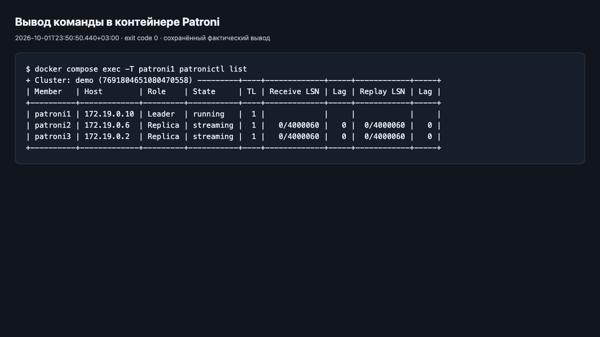
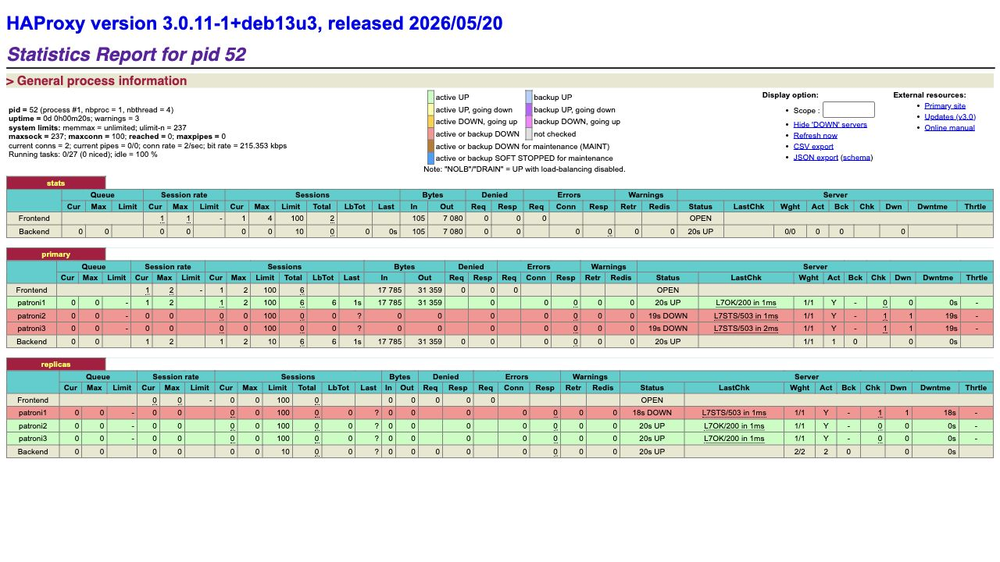
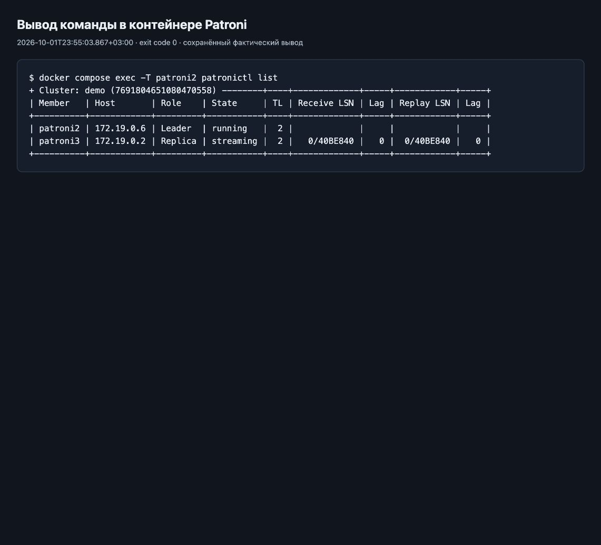
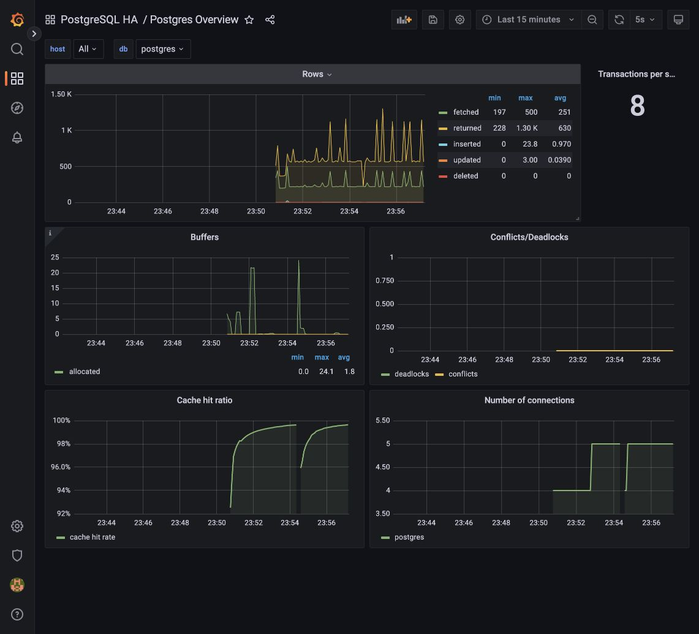
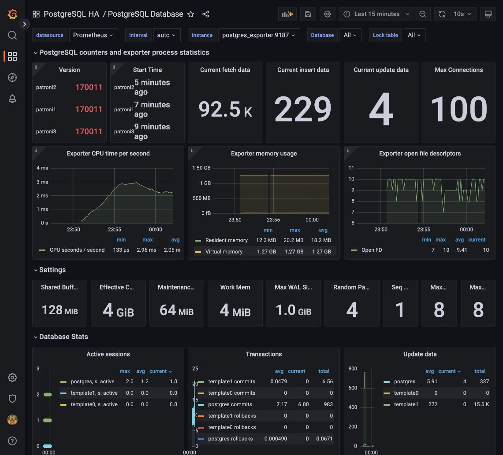
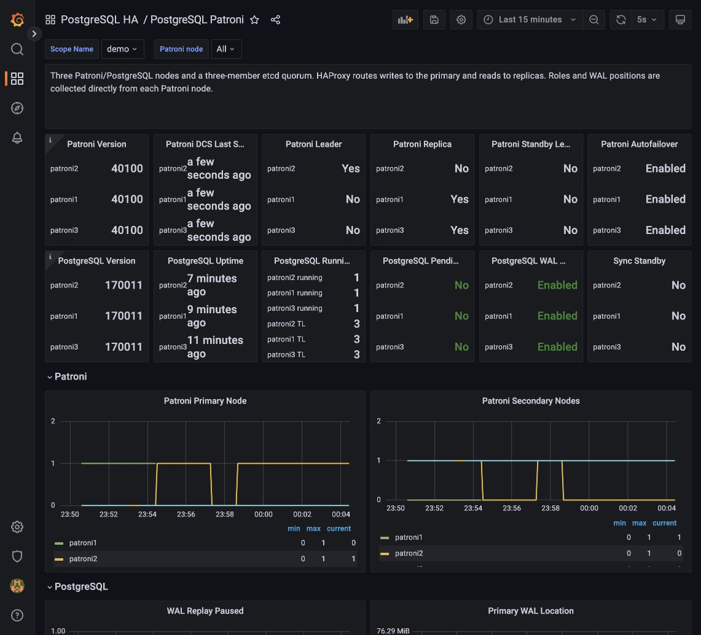

# HW2: PostgreSQL High Availability

## Кластер

Образ Patroni собран, кластер запущен.

| Компонент | Назначение |
| --- | --- |
| PostgreSQL + Patroni | Три ноды: один лидер и две реплики. Patroni управляет PostgreSQL и автоматически выбирает нового лидера при отказе. |
| etcd | Три узла хранят состояние кластера. Для работы нужен кворум — два узла. |
| HAProxy | Направляет запись на лидера, а чтение — на реплики. |

Исходный лидер — patroni1, реплики — patroni2 и patroni3.
Обе реплики находились в состоянии `streaming`, отставание было нулевым.

## HAProxy, данные и нагрузка

В секции `primary` доступен patroni1, в `replicas` — patroni2 и patroni3.
Статус `DOWN` у здоровой ноды в секции чужой роли означает, что она не подходит
для этого маршрута.

SQL из задания загружен: созданы таблицы owners и events, связи, индексы,
комментарии и исходные данные.

Генератор записывал события через порт **5001** на patroni1 и читал через
порт **5002** с patroni3. Новые записи появлялись в БД. Во время экспериментов
генератор не останавливался.

## Отказы и восстановление

Контейнеры по очереди останавливались и запускались обратно.

| Сценарий | Работа приложения | Состояние кластера после возврата ноды |
| --- | --- | --- |
| Реплика patroni3 | Запись продолжалась. Чтение временно прервалось, затем восстановилось на patroni2. | patroni3 вернулась репликой, лидер patroni1 сохранился. |
| Лидер patroni1 | Запись временно прервалась, затем восстановилась на новом лидере patroni2. Чтение переключилось на patroni3. | patroni1 вернулась репликой; лидером осталась patroni2. |
| Один etcd | Чтение и запись продолжались без ошибок: два оставшихся узла сохраняли кворум. | Роли PostgreSQL не изменились. |
| Два etcd | Кворум потерян, запись остановилась. Чтение с реплики продолжалось. После возврата etcd запись восстановилась. | patroni2 снова стала лидером, две остальные ноды — репликами. |
| HAProxy | И чтение, и запись остановились, хотя БД оставались здоровыми. После запуска HAProxy оба потока восстановились. | Роли PostgreSQL не изменились. |

При потере кворума etcd Patroni не мог поддерживать лидерский ключ и понизил
роль текущего лидера. Это остановило запись до восстановления кворума.

Единственный HAProxy — точка отказа клиентского доступа. Для production нужны
несколько балансировщиков с общим отказоустойчивым адресом, например VIP
с переключением или управляемый балансировщик.

## Grafana

`Postgres Overview` показывает активность БД и подключения.
После смены лидера меняются счётчики и cache hit ratio.

`PostgreSQL Database` показывает SQL-статистику и настройки БД.
Панели ресурсов процесса относятся к exporter.

На `PostgreSQL Patroni` видны смена лидера patroni1 → patroni2 и период
без primary при потере кворума etcd.

## Результат

После экспериментов чтение и запись восстановились. Лидер — patroni2,
реплики — patroni1 и patroni3. Генератор добавил 326 событий;
все подтверждённые записи сохранились.
